  

# SDrole

**Developer · Physics and mathematics student**

I write code to explore physics. I’m drawn to questions where mathematical models and computation meet, especially in quantum mechanics and astrophysics. I also practice offensive security and red-team techniques in authorized labs and training environments.

## What I work on

### 🟠 Software development

I build scientific software in C++. I care about how a model turns into code, how to catch numerical errors, and how to make the results reproducible.

### 🟣 Physics and mathematics

My interests span **quantum mechanics and astrophysics**, with a particular interest in relativistic systems. I use numerical simulation to explore what equations predict and where a model’s assumptions matter.

### 🟢 Cybersecurity

I’m interested in **offensive security and red teaming**: understanding how systems fail and practicing adversarial thinking in authorized environments.

  

*Illustrative photon trajectories near a black hole.*

## Featured project

### [BlackHoleSim](https://github.com/SDrole/blackholesim)

A C++17/CUDA project for Kerr ray tracing and relativistic fluid simulation. I’m working toward a GRMHD pipeline where fluid snapshots can feed the renderer. The project README covers the physics and numerical validation.

<!-- latest:start -->
**Latest:** [`blackholesim`](https://github.com/SDrole/blackholesim/commits/main) — active development
<!-- latest:end -->

## Languages on GitHub

<!-- Language card generated with GPRM (https://gprm.itsvg.in/) -->
