  

  
  

Student working on numerical physics and scientific computing. Offensive-security practice is limited to authorized labs and training environments.

## BlackHoleSim · [Explore the code](https://github.com/SDrole/blackholesim)

C++17/CUDA codebase for Kerr ray tracing and relativistic hydrodynamics.

| Area | Implemented |
| --- | --- |
| Geodesics | Hamiltonian null-ray integration in Kerr spacetime |
| Hydrodynamics | SRHD · HLLE · PLM · SSPRK2 · exact Riemann oracle |
| Compute / I/O | OpenMP · CUDA · HDF5 |

### Validation

| Check | Result |
| --- | --- |
| Relative Carter drift | `1.95819e-7` |
| Regression assertions | `147 / 0 failures` |
| S2 validation states | `145,036 / 0 failures` |

### In progress

General-relativistic magnetohydrodynamics (GRMHD).

<!-- latest:start -->
**Latest:** [`blackholesim`](https://github.com/SDrole/blackholesim/commits/main) — active development
<!-- latest:end -->

### Toolchain

  
  
  
  
  
  

