  

  
  
  

I write numerical code for general-relativistic ray tracing and relativistic hydrodynamics, and I do offensive-security work in authorized lab environments.

## [blackholesim](https://github.com/SDrole/blackholesim)

A C++17/CUDA numerical codebase for Kerr ray tracing and relativistic hydrodynamics.

| SYSTEM | CURRENT IMPLEMENTATION |
| --- | --- |
| Spacetime | Kerr ray tracing; Kerr–Schild geometry for the solver track |
| Geodesics | Hamiltonian null-geodesic integration |
| Fluids | SRHD implemented; GRHD / GRMHD on roadmap |
| Numerics | HLLE · PLM · SSPRK2 · exact SRHD Riemann oracle |
| Compute | OpenMP CPU · CUDA GPU |
| I/O | HDF5 |

**VALIDATION**  `Carter Δ = 1.95819e-7` · `S0–S3 = 147 assertions / 0 failures` · `S2 = 145,036 states / 0 failures`

## Security

Offensive-security practice is limited to authorized labs and training environments.

## Stack

`C++17` `CUDA` `OpenMP` `CMake` `HDF5` `Python` `Arch Linux` `Git`
